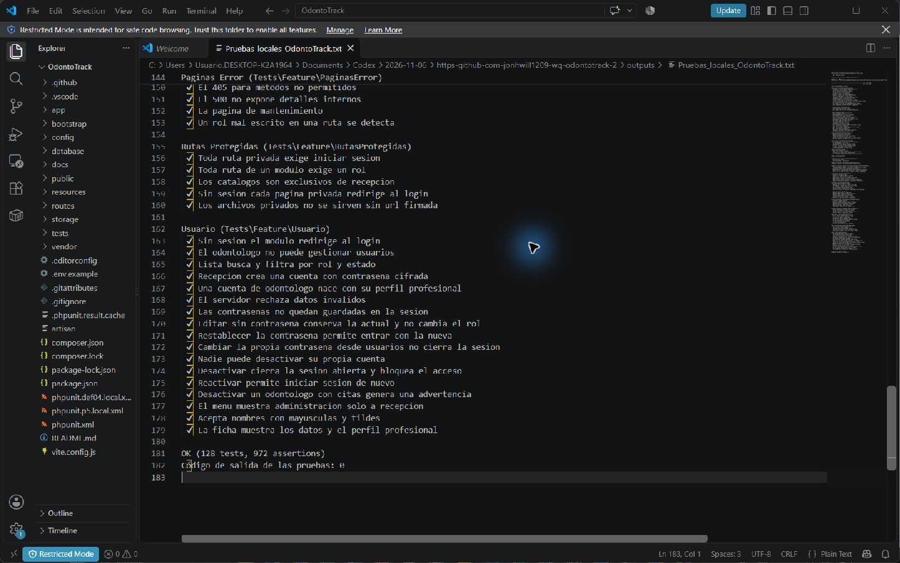
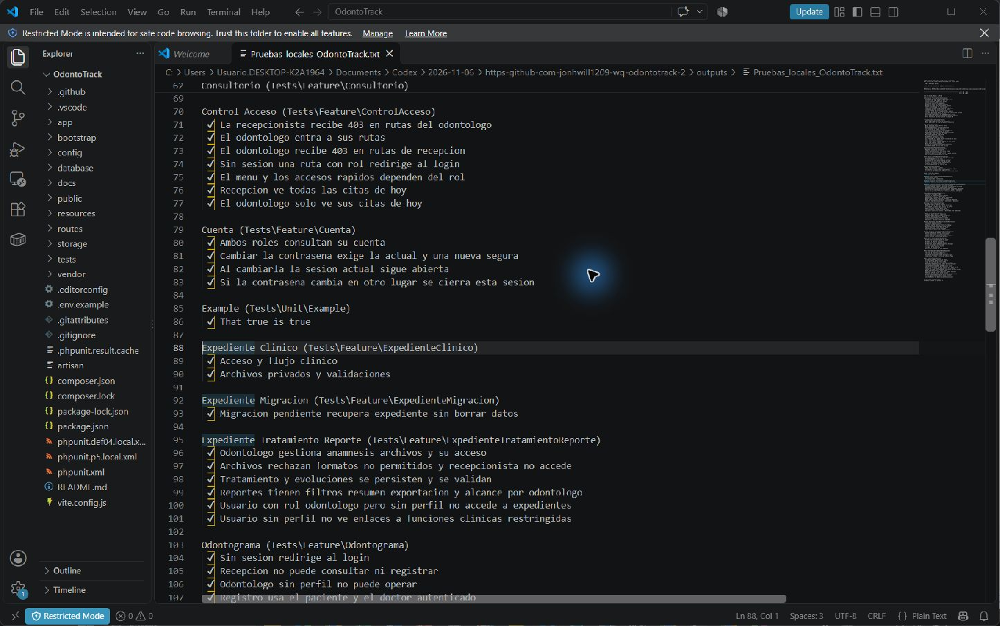

# Evidencias de validación P5

Validación realizada el 8 de noviembre de 2026 sobre la rama `fix/p5-def04-migraciones`, commit de implementación `178286b`, en la computadora de Soophi00. Se utilizó PHP 8.5.11 y MySQL 8.4.3 en una instancia de pruebas aislada, en el puerto 33316, con la base `odontotrack_def04_test`.

## Resultado de la batería completa

**128 pruebas aprobadas y 972 aserciones. Código de salida 0.**

Se ejecutó PHPUnit con `--testdox` y configuración local de pruebas. El registro incluye autenticación, roles, pacientes, agenda, expedientes, odontograma, tratamientos, archivos, reportes y exportaciones. La instancia temporal de MySQL se cerró al terminar. Las capturas muestran el registro real abierto en VS Code; no son capturas de una validación manual del navegador.

## Regresión del expediente

`ExpedienteMigracionTest` simula una instalación anterior a la tabla `expediente_archivo`, aplica la migración existente, abre el expediente con respuesta 200, comprueba que se conservan paciente y anamnesis y vuelve a ejecutar el comando sin duplicar el expediente. Se mantienen también las pruebas de acceso clínico, adjuntos y permisos.

[Registro completo de ejecución](Pruebas_locales_OdontoTrack.txt)

## Alcance del cierre

El error de tabla faltante recibido como DEF-04 corresponde a DEF-10 en el registro consolidado. La migración ya existe en develop; una instalación con ese error debe verificar su conexión y aplicar las migraciones pendientes con `php artisan config:clear`, `php artisan migrate:status` y `php artisan migrate`, y volver a revisar el estado. No debe reconstruirse la base con `migrate:fresh`.

No se ejecutaron migraciones en la computadora de la persona que reportó el error. Después de actualizar su instalación debe revalidar el recorrido con el mismo paciente. La evidencia automatizada no sustituye esa comprobación manual.
