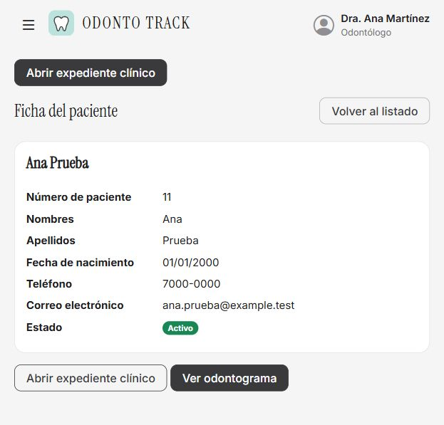
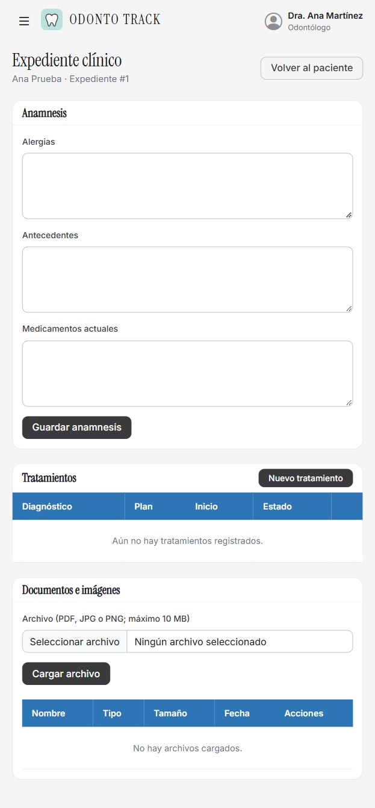
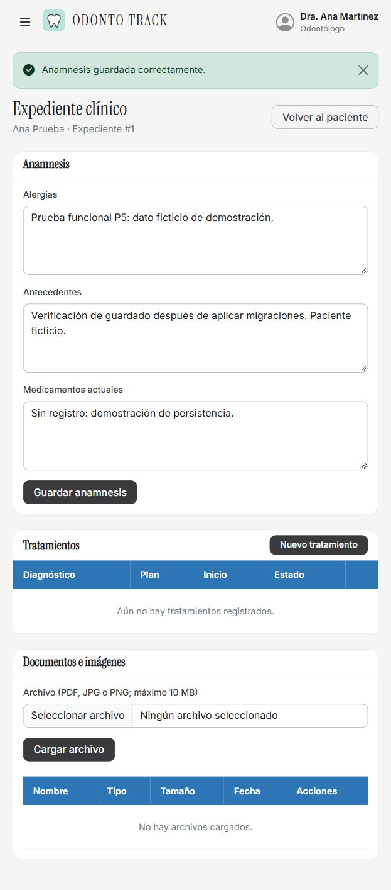
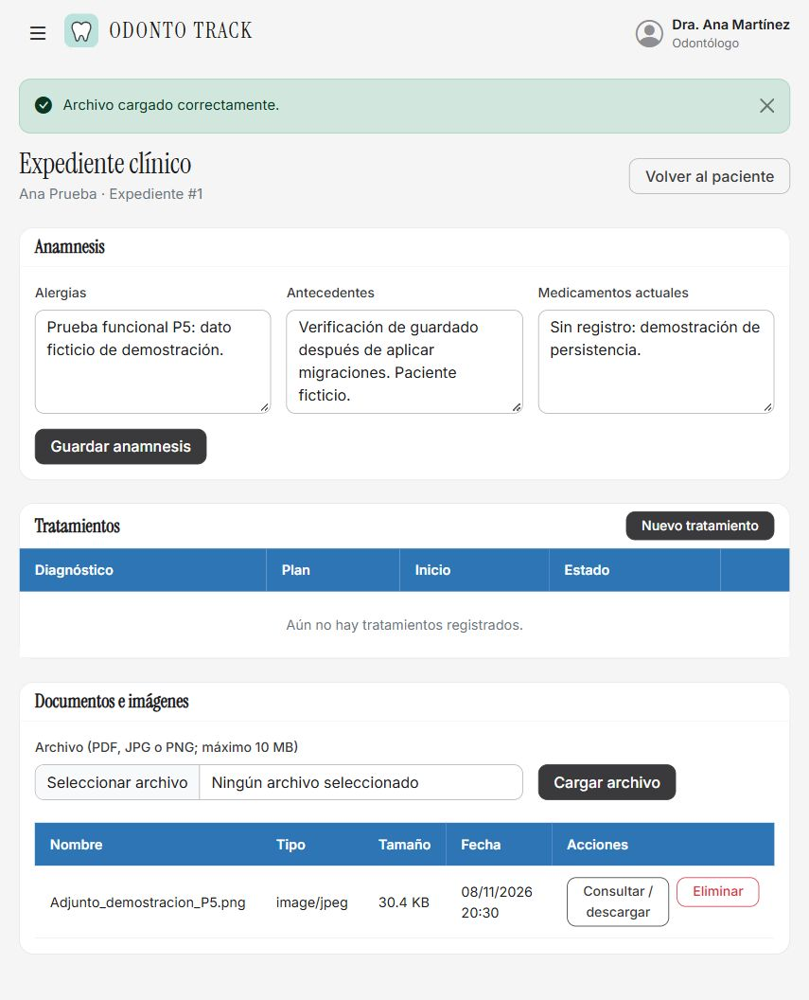
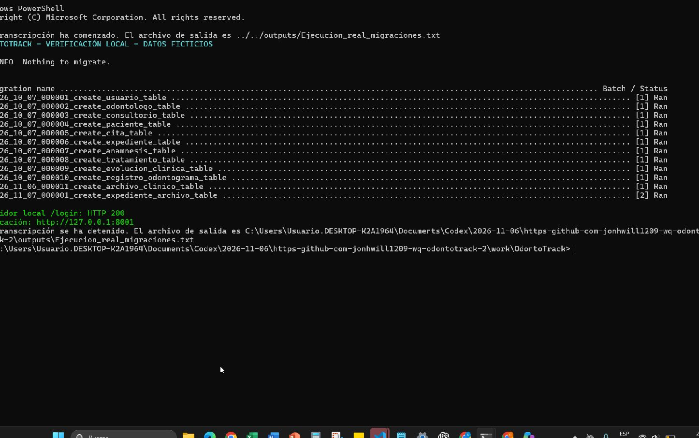

# Recorrido real de la aplicación P5

Fecha local de verificación: 8 de noviembre de 2026. Aplicación ejecutada en la computadora de Soophi00 en http://127.0.0.1:8001, con PHP 8.5.11 y MySQL 8.4.3.

Se utilizó una base de demostración independiente (`odontotrack_demo_p5_20261108`) con pacientes y datos ficticios. No se actualizó la base de la persona que reportó el error.

## Procedimiento y resultado

1. Se preparó la base de demostración con las migraciones anteriores a `2026_11_07_000001_create_expediente_archivo_table`. Esta última quedó pendiente.
2. Se aplicó la migración pendiente usando el comando real `php artisan migrate` al iniciar el servidor local. El estado posterior confirma `[2] Ran` para la tabla de adjuntos. Una nueva ejecución devuelve `Nothing to migrate`.
3. Se inició sesión con el perfil odontológico de demostración de Dra. Ana Martínez.
4. En Pacientes se buscó el apellido Prueba, se abrió la ficha de Ana Prueba y se pulsó Abrir expediente clínico. El expediente cargó sin Error 500.
5. Se guardó una anamnesis ficticia mediante el formulario y se recargó la página. Los datos se conservaron.
6. Se cargó una imagen de demostración (captura del login, no una radiografía clínica), se mostró el mensaje Archivo cargado correctamente y se descargó usando Consultar / descargar.
7. Se comprobó la respuesta HTTP 200 de /login desde la consola y el estado aplicado de las migraciones.

La descarga del adjunto coincide byte por byte con el archivo de origen: sí.

## Capturas directas

Las imágenes se capturaron directamente de la pantalla o del navegador durante el recorrido; no se generaron imágenes del aplicativo ni se reconstruyó su interfaz. No se añadieron textos o resultados sobre las capturas. La imagen de consola corresponde a la terminal real, que se abrió con los comandos locales de verificación. Las capturas del navegador son de la página completa.

### Ficha del paciente

### Expediente abierto sin el error reportado

### Guardado desde el formulario

### Adjunto cargado en el expediente

### Consola real de migraciones

[Salida relevante de la consola](Consola_migraciones_salida.txt). Se omitió la cabecera de identificación del equipo de la transcripción publicada.

## Alcance

Este recorrido verifica manualmente en el navegador local la recuperación del acceso al expediente y las operaciones descritas; complementa la batería automatizada de 128 pruebas y 972 aserciones. No certifica todos los módulos ni todos los navegadores. Cada instalación debe aplicar sus propias migraciones antes de la RC.
